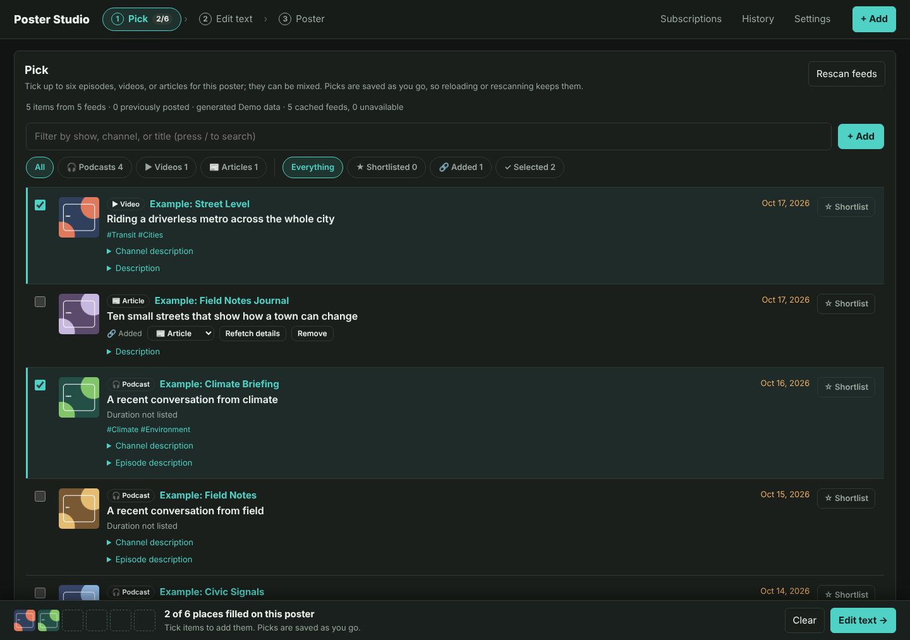
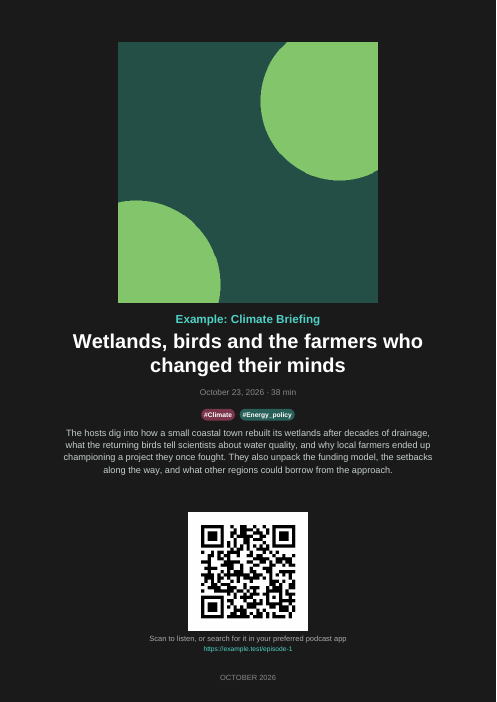
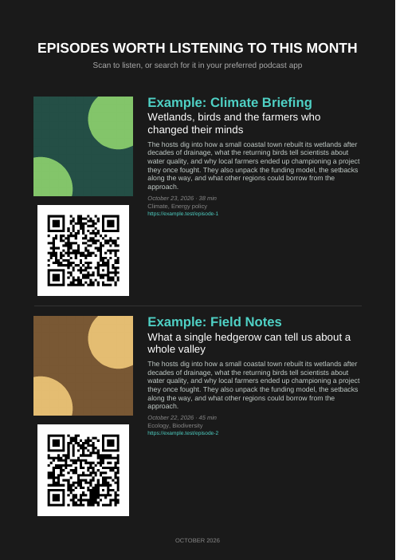
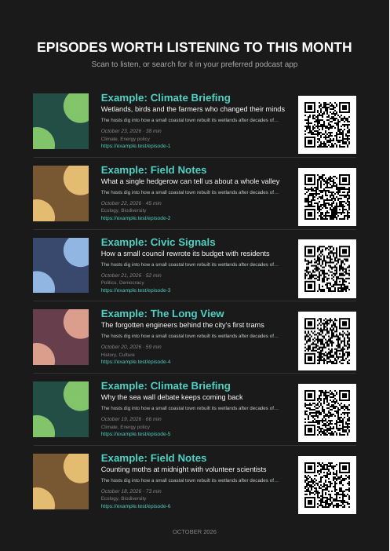
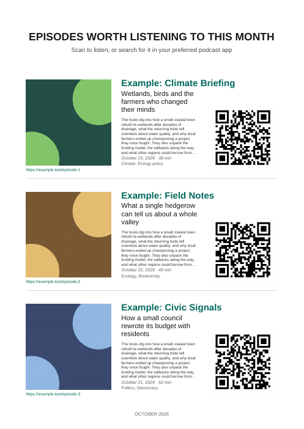
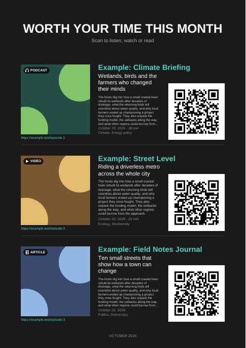

# Poster Studio

A local tool for picking podcast episodes, videos, and articles and printing them on a one-page PDF poster with QR codes. Follow podcasts, YouTube channels, and blogs through their feeds, or add single items by pasting a link.



The screenshot uses fictional demo subscriptions and artwork; it contains no personal feed data.

## Poster layouts

| Single episode | List, 2 episodes | List, 3 episodes | List, 6 episodes | Ink-saving theme | Mixed media |
| --- | --- | --- | --- | --- | --- |
|  |  |  |  |  |  |

The **single-episode** layout leads with large artwork, then the channel, episode title, date and duration, tags, and summary, with the QR code below. The **list** layout holds up to six episodes and uses the room it has: with fewer episodes the type grows and summaries get more lines. With one or two episodes, the QR code moves under the artwork so the text spans the page. Summaries shrink before being cut short. Both layouts come in a dark theme and a white **ink-saving** theme. A poster of one media type says so in its heading ("Episodes worth listening to", "Videos worth watching", "Reads worth your time"). A **mixed** poster gets a neutral heading ("Worth your time this month"), a scan line naming what to do ("Scan to listen, watch or read"), and a small 🎧 PODCAST, ▶ VIDEO, or 📰 ARTICLE badge on each item's artwork. Headings can be changed in `user-data/config.json` (`poster_title`, `video_poster_title`, `article_poster_title`, `mixed_poster_title`).

These examples use fictional episodes, videos, and articles. Regenerate them with `.venv/bin/python docs/capture_poster_examples.py` (needs `pdftoppm` from poppler-utils).

## Requirements

- Python 3.10 or newer
- An AntennaPod OPML export to scan the full subscription list
- Optional: [`just`](https://just.systems) for command shortcuts

## Setup

Clone or download the repository, then run:

```sh
just setup
```

This creates a virtual environment, installs the Python dependencies, and copies `config.example.json` to `user-data/config.json` if you do not already have a local config. Without `just`, create the environment and config manually:

```sh
python3 -m venv .venv
. .venv/bin/activate
python -m pip install -r requirements.txt
mkdir -p user-data
cp config.example.json user-data/config.json
```

Copy your AntennaPod OPML export to `user-data/subscriptions.opml`. The example config already points there. Edit `user-data/config.json` to set preferences.

## Keep personal data local

Everything under `user-data/` is ignored by Git. It is intended for personal and generated files, including your OPML subscriptions, your added-item feeds (`user-data/feeds/`), your settings (`config.json`), poster draft (`draft.json`), shortlist (`shortlist.json`), and channel notes (`channel-notes.json`), downloaded feed/artwork cache, candidate review page, generated PDFs, poster history, and saved LLM drafts (`llm-suggestions.json`). The history is used to flag episodes that appeared on earlier posters; saved LLM drafts mark processed episodes and are versioned so newer suggestion rules can make old drafts eligible for reprocessing.

Keep reusable code, tests, and `config.example.json` in the repository; do not add your personal config, subscriptions, cache, history, or generated posters to a shared repository. `config.json` holds settings only; what you build up while using the studio sits beside it in `draft.json`, `shortlist.json`, and `channel-notes.json`. A `config.json` from before this split that still holds `slots`, `shortlist`, or `subscription_metadata` keeps working: `just web` moves them into those files the first time it starts. Poster generation needs at least one slot in your draft.

If you previously used the old `tools/episode-browser.html`, check its data for credential-bearing feed URLs and rotate any exposed credentials before sharing or publishing them.

## Commands

Run `just` to list recipes:

- `just setup` creates the local config if needed and installs dependencies.
- `just episodes` scans the full OPML feed history and builds the chronological review page. Extra script arguments can be forwarded, for example `just episodes -- --opml /path/to/feeds.opml`.
- `just resolve` resolves configured slot show names against the OPML and writes `user-data/resolved_feeds.json`.
- `just poster` generates the poster PDF and archives its snapshot.
- `just web` starts the local browser-based workflow.
- `just test` runs the unit test suite.
- `just check` checks Python syntax and local config JSON.

The commands can also be run with `.venv/bin/python` directly, for example `.venv/bin/python fetch_episodes.py`.

## Use the integrated web workflow

Start the local server with:

```sh
just web
```

Open `http://127.0.0.1:8765/`. **+ Add** (top right, and beside the Pick list) is the one place to bring in new things; see [Add channels, feeds, and single items](#add-channels-feeds-and-single-items). Making a poster takes three steps, shown across the top:

1. **Pick** — tick up to six items (click anywhere on a row). Every row is labelled 🎧 Podcast, ▶ Video, or 📰 Article. Narrow the list by media type (**All**, **🎧 Podcasts**, **▶ Videos**, **📰 Articles**; remembered in this browser), by **★ Shortlisted**, **🔗 Added**, or **✓ Selected**, or by show, channel, or title (press `/`). A poster can mix media types. Use **☆ Shortlist** to keep an item for a later poster without adding it to this one. Items that appeared on an earlier poster are labelled, and you get a heads-up when you tick one.
2. **Edit text** — edit the summary and tags printed for each episode, and set the poster order with ↑ ↓. **Reset to feed text**, **Use channel tags**, and (with an LLM configured) **Suggest with AI** / **Use saved AI draft** each offer an Undo.
3. **Poster** — preview the poster and choose the layout (List, or Single item when exactly one is picked) and theme. Previewing never touches history. **Generate & archive** saves the poster to History; the page then shows **Print PDF**, **Download PDF**, **Mark printed**, and **Start a new poster**. Generating the same poster twice is not possible: change the episodes, text, layout, or theme to make a new version.

Your picks and edits are the *poster draft*. It is saved on the server as you go (in `user-data/draft.json`), so reloading the page, rescanning feeds, or coming back later keeps it. Each step is its own address (`#pick`, `#edit`, `#poster`), so reloads and the browser's back button stay where you are. A tray at the bottom of Pick and Edit shows how many of the six places are filled and links to the next step. Shortlisted episodes are removed from the shortlist once they are archived on a poster. If a feed drops an episode you picked or shortlisted, it stays listed (marked as no longer in the latest scan) so you can still use or remove it.

**Subscriptions**, **History**, and **Settings** sit to the right of the steps:

- **Subscriptions** lists the three added-item feeds (with item counts and links to their RSS files) and the feeds you follow, each labelled with its media type. It imports or exports OPML. Import defaults to **Merge**, which keeps current feeds and adds new URLs without duplicates; choose **Replace** to swap the list (the app asks for confirmation). **Scan feeds** loads every episode the feeds provide; it is also available as **Rescan feeds** in Pick.
- **History** lists archived posters with **Print PDF**, **Download PDF**, **Preview PDF**, and **Regenerate PDF** (re-render with the current layout code). Mark each poster printed after printing or publishing it. Unprinted entries can be deleted normally; printed or older entries have an explicit **Force delete** action. **Clear poster archive** removes archived poster records and PDFs (printed and unprinted) while keeping subscriptions, episode data, caches, your poster draft, and the current poster PDF. Deleting history also removes its episode warnings.
- **Settings** configures the optional LLM connection described below.

The server binds only to loopback and is intended for local use. Stop it with Ctrl-C.

**Settings** shows whether common LLM environment variables are present. The app checks `LLM_BASE_URL`, `OPENAI_BASE_URL`, `OPENAI_API_BASE`, or `OLLAMA_HOST`, plus optional model (`LLM_MODEL`, `OPENAI_MODEL`, `OLLAMA_MODEL`) and key (`LLM_API_KEY`, `OPENAI_API_KEY`, `OLLAMA_API_KEY`) variables. It only reports key-variable presence; secret values are never shown or saved. LLM connections are disabled by default, and startup does not probe ports or contact a model. If no endpoint is detected, Settings pre-fills `http://127.0.0.1:8080/v1` as an unverified suggestion; edit it if your service uses another address. Enable the connection to opt in; **Test connection** then requests only the service's model list. Choose a model ID from that list for suggestions. OpenAI-compatible and Ollama APIs are supported. The configured endpoint may be remote; only use a service you trust.

With an LLM configured, **Pick** shows an **AI drafts** bar: set **Batch size** (default 10, up to the number of eligible episodes) to choose how many of the newest unprocessed or older-version episodes **Process newest X of Y** handles per run. Each run asks for confirmation, processes one episode at a time, saves drafts under `user-data/llm-suggestions.json`, and marks each completed episode; **Stop after current** ends the batch safely. Another batch starts only when you click again. Each processed row shows an inline AI summary snippet; expand it to read the full summary and tags. An episode picked after it was processed starts from its AI draft; in **Edit text**, **Use saved AI draft** applies a draft made later, and **Suggest with AI** regenerates one episode. Scans never make LLM requests. Bump `LLM_SUGGESTION_VERSION` in `server.py` when changing suggestion prompts or output rules; old-version drafts then become eligible for bulk reprocessing.

## Add channels, feeds, and single items

Choose **+ Add**, paste one or more links (one per line), and choose **Check links**. Nothing is added until you confirm. For each link the app works out what it is and pre-ticks the likely choice:

- **Follow** a channel or feed: a YouTube channel (`/@handle`, `/channel/UC…`) or playlist, a podcast feed or Apple Podcasts show page, or a blog or newsletter (its home page or feed URL). Followed feeds go into your OPML and are scanned straight away; after that, every scan brings in their new items. YouTube publishes a feed of each channel's and playlist's latest ~15 videos (without durations). YouTube's feeds sometimes fail for hours at a time; a channel can still be followed then, and later scans pick up its videos once the feed is back. You can also add a YouTube channel to an OPML file by hand as `<outline type="rss" text="Channel name" xmlUrl="https://www.youtube.com/feeds/videos.xml?channel_id=UC…"/>`.
- **Add** a single video, episode, or article: a YouTube or Vimeo video, an Apple Podcasts, Spotify, or SoundCloud episode, or any web page. Choose its media type in the preview if the guess is wrong. A video also offers to follow its channel, and an article offers to follow its site's feed. Spotify shows have no public feed, so only their single episodes can be added.

Each row can also take optional details before you confirm: for a single item, your own title, poster summary, and tags; for a feed you follow, a channel note and default tags (saved like the notes on **Subscriptions**). Typing in them ticks that row. Anything you type here is kept when the item's details are fetched later, and an item's fetched description is still stored alongside your summary.

Single items are not subscriptions, so they are not written to your OPML. Each media type has its own feed of added items: `user-data/feeds/added-podcasts.xml`, `added-videos.xml`, and `added-articles.xml`. These are standard RSS 2.0 files (using the iTunes and Media RSS namespaces), served at `http://127.0.0.1:8765/feeds/added-videos.xml` and so on, so a feed reader on this computer can follow them too. The app's own bookkeeping, such as when an item was added and whether its details have been fetched, uses a small `pps:` namespace that other readers ignore.

An added item appears in Pick at once, so it can be shortlisted or ticked straight away. Its title, channel or site, date, duration, description, and artwork are then fetched from the provider's oEmbed endpoint and the page's Open Graph, schema.org, and `<title>` metadata. Details that arrive after an item was shortlisted or picked fill in those copies too, without replacing a summary or tags you already edited. Items without a publish date are dated by when you added them ("Added October 24, 2026"). An item whose page cannot be read stays listed with a **Retry** button. Every added item also has a media-type menu (changing it moves the item to that type's feed), **Refetch details**, and **Remove**.

How media types are decided: a YouTube or Vimeo feed is video, a feed whose entries carry audio files is a podcast, and any other feed is articles. Added items have the type chosen when they were added.

Your shortlist and your poster archive are RSS feeds too: `http://127.0.0.1:8765/feeds/shortlist.xml` lists shortlisted items, and `http://127.0.0.1:8765/feeds/posters.xml` has one entry per archived poster with its PDF attached. Links to them are on **Subscriptions** and **History**.

## Review all available episodes

Run:

```sh
just episodes
```

The scanner fetches feeds from the configured OPML and creates `user-data/episode-candidates.html`, sorted newest-first across the full episode history each feed provides. Results are paged 200 at a time. Feed responses are cached under `user-data/cache/feeds/`; if a feed is temporarily unavailable, its cached response is used when possible. Channel artwork is downloaded once per show, resized, and cached under `user-data/cache/artwork/`. Cached artwork preserves transparency for both poster themes; the first scan after the artwork-cache format update may download artwork again. For the three newest episodes of each show, the scanner also downloads episode-specific artwork when the feed provides it; that image is preferred, with channel art as the fallback. Older episodes reuse channel art. Images are cached by source, and the review page lazy-loads visible thumbnails. Feed descriptions appear in expandable, plain-text summaries capped at 400 characters. Episode durations are shown when feeds provide them. Missing or unavailable artwork gets a simple placeholder. The page compares episodes with `user-data/history/posters/` and labels episodes that appeared on an earlier poster. You can still select one intentionally; the page warns when you do. In the web app this page is the **Pick** step. Opened directly as a standalone HTML file, it has its own **Review** step for summaries (up to 400 characters) and tags, and downloads the result as fixed slots that you can add to `user-data/config.json`.

## Subscription notes and tags

On **Subscriptions**, each feed shows cached channel artwork when available (falling back to episode artwork). Open **Edit channel note and tags** on a feed to write a local editorial note (up to 400 characters) and default tags, then **Save note and tags**. With an LLM configured, **Suggest with AI** fills that editor for review (nothing is saved until you click save), and the bulk **Fill in first X of Y with AI** control fills in channel notes and default tags for the selected number of incomplete subscriptions, processing feeds in OPML order because OPML has no subscription timestamps. Batch size defaults to 10 and is limited only by the remaining incomplete subscriptions. Each batch asks for confirmation; **Stop after current** lets you halt a long run after the active feed request finishes. This sends each feed's RSS description and up to three recent episode samples to your configured LLM and saves successful results while preserving any existing description or tags. For example, a channel note can say “Greens-affiliated podcast” and its default tag can be `Environment`. These annotations are stored in `user-data/channel-notes.json`, keyed by feed URL; they do not modify your OPML. Native channel descriptions from the RSS feed remain available as a fallback when no custom note is saved.

Episodes inherit their subscription's default tags in the episode list, and a picked episode starts with them (or with its AI draft's tags). In **Edit text**, change an episode's tags when its topic differs, or use **Use channel tags** to go back to the defaults; clearing the input removes the tags for that episode. Tags are comma-separated, deduplicated case-insensitively, and limited to 12 labels of 40 characters each. Poster tags print as hashtags; channel notes are review metadata and are not printed.

## Configure poster slots

`user-data/draft.json` is the source of truth for poster content: a JSON list of slots that the browser workflow edits as your poster draft. Each slot is either fixed to a specific episode:

```json
{
  "type": "fixed",
  "show": "Example Podcast",
  "episode": "A selected older episode",
  "date": "October 12, 2024",
  "url": "https://example.com/episode",
  "feed_url": "https://example.com/feed.xml",
  "summary": "An optional short, edited blurb to print on the poster."
}
```

or dynamic, resolving to the newest dated episode in its feed each time the poster is generated:

```json
{
  "type": "latest",
  "show": "Example Podcast",
  "feed_url": "https://example.com/feed.xml"
}
```

The list poster supports up to six slots. Set `poster_layout` to `"list"` or `"single"` in `user-data/config.json`; the single layout requires exactly one slot and prints no heading, leading with the episode artwork (`single_poster_title` only names it in poster history). Set `poster_theme` to `"dark"` (default) or `"ink-saving"` for a white background. The browser workflow exposes both layout and theme selectors and saves them as you change them. Dynamic latest slots appear in the browser workflow's Edit step, where they can be reordered or removed but have no text to edit. Tags are rendered as stable-color, wrapping hashtag bubbles, with as many shown as fit the episode area. If a fixed slot includes a `summary`, it is printed as a short excerpt on the poster. A slot's `tags` override the subscription defaults; omit `tags` in manually configured slots to inherit defaults, or use an empty list to explicitly clear them. Dynamic latest slots also inherit subscription notes and tags. Feed URLs are used for dynamic lookup and artwork; artwork is cached under `user-data/cache/artwork/`, with title-colored placeholder artwork used when no episode or channel art is available.

## Generate and retain posters

Run:

```sh
just poster
```

The output path is configured by `output_pdf` (default: `user-data/podcast-poster.pdf`). Each successful generation also saves a timestamped PDF and a JSON snapshot of its resolved slots, title, and edition under `user-data/history/posters/`. The snapshots flag episodes already posted. Set `poster_period` to `month` or `week` to control the edition label.
